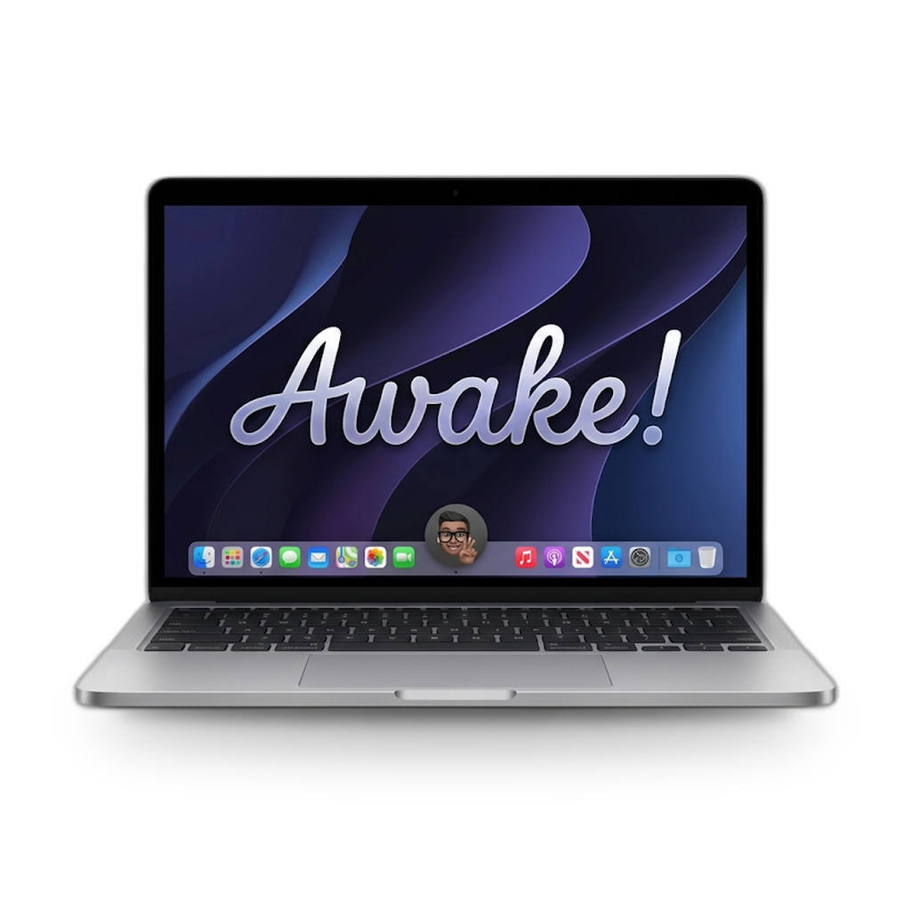
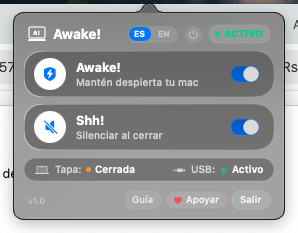
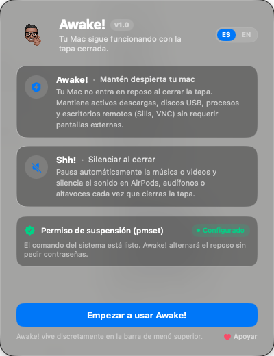
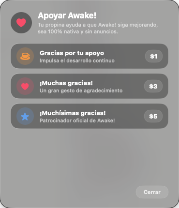
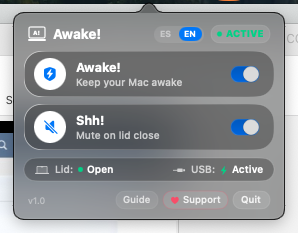
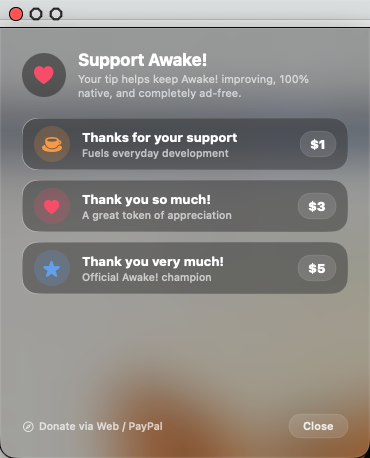

<div align="center">



# Awake! 💻⚡

**Mantén despierta tu Mac con la tapa cerrada sin pantallas externas, con protección total de USB, servicios en segundo plano y silencio inteligente.**

*Keep your Mac fully awake when the lid is closed without external monitors, with complete USB protection, active background services, and smart auto-mute.*

[](https://github.com/Alex-Louder/Awake/releases)
[](https://alex-louder.github.io/Awake/)
[](https://www.apple.com/macos/)
[](https://github.com/Alex-Louder/Awake)
[](LICENSE)
[](https://ko-fi.com/alexlouder)

[🌐 Sitio Web Oficial](https://alex-louder.github.io/Awake/) • [🇲🇽 Leer en Español](#-español) • [🇺🇸 Read in English](#-english)

</div>

---

<a name="-español"></a>
# 🇲🇽 Español

## 💡 El Problema que Resuelve Awake!

En macOS, cuando cierras la tapa de tu MacBook sin tener conectado un monitor externo, el sistema suspende de forma agresiva:
- ❌ Se cortan las descargas activas, renderizados de video y procesos de IA/ML.
- ❌ Se detienen servidores locales (Docker, Node.js, Python, PostgreSQL, etc.).
- ❌ Se desconectan hubs y puertos USB, expulsando discos duros y apagando tarjetas de sonido externas.
- ❌ Aplicaciones de escritorio remoto (**Sills, VNC, RustDesk, TeamViewer, AnyDesk**) sufren de **pantalla negra** porque el WindowServer apaga el framebuffer del display.

Las herramientas clásicas de "caffeinate" no resuelven esto: mantienen la CPU activa temporalmente, pero **no impiden que el hardware entre en Clamshell Sleep**. Otras herramientas complejas requieren instalar kexts antiguos o te piden la contraseña de administrador repetidamente.

**Awake!** resuelve todo esto de forma nativa, segura y elegante:
1. Impide el reposo por tapa cerrada vía `pmset disablesleep 1`.
2. Mantiene la alimentación ininterrumpida en todos los puertos y hubs USB.
3. Atenúa la pantalla a brillo 0 sin apagar la GPU, permitiendo que las sesiones remotas sigan funcionando al 100%.
4. Silencia inmediatamente el audio y pausa videos al bajar la pantalla (función **Shh!**).
5. Requiere **0 contraseñas** en el día a día gracias a una regla segura y restringida de sudoers.

---

## 📊 Comparativa de Características

| Característica | **Awake!** 💻⚡ | **Amphetamine** 💊 | **Apple Caffeinate** ☕ |
| :--- | :---: | :---: | :---: |
| **Tapa cerrada sin monitor externo (Clamshell)** | ✅ **Nativo (pmset)** | ⚠️ Requiere extensiones complejas | ❌ No soportado |
| **Mantiene energía en puertos & hubs USB** | ✅ **100% Protegido** | ⚠️ Se desconectan al cerrar | ❌ Se suspenden |
| **Escritorio Remoto (Sills, VNC) sin pantalla negra** | ✅ **Garantizado** | ❌ Pantalla negra frecuente | ❌ Pantalla negra |
| **Silencio Inteligente al cerrar (Shh!)** | ✅ **Nativo (MediaRemote + CoreAudio)** | ❌ No | ❌ No |
| **Solicitudes de contraseña (Prompts)** | ✅ **0 Prompts (100% silencioso)** | ⚠️ Pide contraseña al cambiar | ⚠️ Requiere `sudo` manual |
| **Interfaz de Usuario** | ✅ **Liquid Glass Dark HUD (macOS Sonoma / Sequoia / Golden Gate)** | ⚠️ Menú de texto tradicional | ❌ Solo línea de comandos |
| **Consumo de Memoria** | ✅ **~15 MB RAM** | ~70–120 MB RAM | ~1 MB (CLI) |
| **Código Abierto & Cero Telemetría** | ✅ **100% Open Source** | ❌ Código Cerrado | ✅ Nativo de macOS |

---

## 📸 Capturas de Pantalla

<div align="center">
  <table>
    <tr>
      <td align="center"><b>Menú Liquid Glass Dark HUD</b></td>
      <td align="center"><b>Guía de Inicio & Permisos</b></td>
      <td align="center"><b>Tip Jar / Patrocinio Ko-fi</b></td>
    </tr>
    <tr>
      <td></td>
      <td></td>
      <td></td>
    </tr>
  </table>
</div>

---

## ✨ Características Principales

- **Awake! (Mantén despierta tu Mac):**
  Activa con un clic la permanencia del sistema. Trabaja con tu MacBook en la mochila, transfiere archivos en segundo plano, descarga torrents o ejecuta tareas de IA sin interrupción.
- **Shh! (Silenciar al cerrar):**
  Pausa automáticamente la música o video (`NowPlaying`) y silencia altavoces internos, auriculares y placas de audio USB (Focusrite, SSL, etc.) al detectar el cierre de la tapa. Al reabrir, restaura el volumen previo.
- **Detección de Hardware IOKit en Tiempo Real:**
  Monitorea el sensor magnético del lid (`AppleACPIPlatformExpert` / `IOPMrootDomain`) en tiempo real con cero sobrecarga en la CPU.
- **Onboarding Nativo & Selector Bilingüe:**
  Configuración en un clic. Interfaz con selector dinámico de idioma (Español / Inglés) que actualiza todos los textos en caliente.
- **Diseño Nativo y Minimalista:**
  Panel flotante integrado en la barra de menú con estética nativa de macOS (Dark HUD), esquinas redondeadas y consumo ultraligero de recursos (~15 MB RAM).

---

## 🚀 Instalación

### Opción 1: Descarga directa DMG (Recomendado)
1. Descarga el instalador oficial [Awake-v1.0.0.dmg](https://github.com/Alex-Louder/Awake/releases/latest/download/Awake-v1.0.0.dmg).
2. Abre la imagen de disco y arrastra **Awake!** a tu carpeta de **Aplicaciones**.
3. Al abrirla por primera vez, haz clic en **"Configurar Permiso (1 Clic)"** para activar la autorización sin contraseña.

### Opción 2: Instalación rápida por Terminal (One-liner)
```bash
git clone https://github.com/Alex-Louder/Awake.git && cd Awake && ./install.sh
```

### Opción 3: Compilar desde código fuente
```bash
# Requiere Xcode Command Line Tools o Swift 5.9+
git clone https://github.com/Alex-Louder/Awake.git
cd Awake
./package_release.sh
```
El script generará el binario compilado, la aplicación firmada localmente, el paquete DMG personalizado con fondo Retina y el archivo ZIP en `build/releases/`.

---

## 🔒 Seguridad y Privacidad

Awake! fue concebida bajo el principio de **máxima privacidad y mínima intrusión**:

- **Cero Telemetría:** Awake! no contiene analíticas, no registra eventos, no utiliza Firebase, Google Analytics ni ningún tracker. Cero peticiones de red hacia servidores de terceros.
- **Privilegio Mínimo (Least Privilege):** Para evitar que el sistema entre en reposo con la tapa cerrada, macOS exige permisos de administrador para ejecutar `pmset -a disablesleep`. En lugar de ejecutar toda la app como root o usar un demonio que corra siempre en el sistema, Awake! configura una única regla en `/etc/sudoers.d/awake`:
  ```sudoers
  tu_usuario ALL=(ALL) NOPASSWD: /usr/bin/pmset -a disablesleep *
  ```
  Esto permite que únicamente ese comando exacto se ejecute sin pedir contraseña. La aplicación corre en tu espacio de usuario común (`user space`), sin daemons ocultos.
- **100% Desinstalable:** Si decides desinstalar Awake!, simplemente borra la app y el archivo de sudoers:
  ```bash
  sudo rm -f /etc/sudoers.d/awake
  rm -rf /Applications/Awake\!.app
  ```

---

## ☕ Apoya el Proyecto (Tip Jar)

Awake! es un proyecto independiente desarrollado con mucho cariño y atención al detalle. Si te ahorró tiempo, dolores de cabeza con escritorios remotos o interrupciones en tus descargas, ¡considera invitarme un café!

Puedes apoyar directamente a través de **[ko-fi.com/alexlouder](https://ko-fi.com/alexlouder)**:

| Nivel | Aportación | Enlace Directo |
| :--- | :---: | :---: |
| ☕ **Gracias por tu apoyo** | **$1 USD** | [Apoyar con $1 en Ko-fi](https://ko-fi.com/alexlouder?amount=1) |
| ⚡ **¡Muchas gracias!** | **$3 USD** | [Apoyar con $3 en Ko-fi](https://ko-fi.com/alexlouder?amount=3) |
| 🚀 **¡Muchísimas gracias!** | **$5 USD** | [Apoyar con $5 en Ko-fi](https://ko-fi.com/alexlouder?amount=5) |

---

<br />

<a name="-english"></a>
# 🇺🇸 English

## 💡 The Problem Awake! Solves

On macOS, when you close your MacBook lid without an external display attached, the system forces an aggressive Clamshell Sleep:
- ❌ Active downloads, long video renders, and AI/ML model tasks are killed.
- ❌ Local background servers (Docker containers, Node.js, Python, PostgreSQL) are suspended.
- ❌ USB ports and hubs lose bus power, abruptly ejecting external drives and silencing audio interfaces.
- ❌ Remote desktop sessions (**Sills, VNC, RustDesk, TeamViewer, AnyDesk**) go completely black because WindowServer powers down the display framebuffer.

Standard "caffeinate" tools cannot prevent Clamshell sleep without dummy HDMI dongles or third-party kernel extensions, and often require typing your admin password constantly.

**Awake!** solves this completely, natively, and elegantly:
1. Prevents clamshell sleep directly via `pmset disablesleep 1`.
2. Preserves constant bus power to all USB ports, hubs, and peripherals.
3. Dims the internal screen to 0 brightness while keeping the GPU and WindowServer framebuffer active, ensuring remote sessions run seamlessly.
4. Pauses media and mutes all audio when the lid is closed (**Shh!** feature).
5. Requires **0 password prompts** during daily use via a strictly scoped sudoers rule.

---

## 📊 Feature Comparison Matrix

| Feature | **Awake!** 💻⚡ | **Amphetamine** 💊 | **Apple Caffeinate** ☕ |
| :--- | :---: | :---: | :---: |
| **Lid closed without external monitor** | ✅ **Native (pmset)** | ⚠️ Requires helper extensions | ❌ Not supported |
| **Maintains USB port & hub bus power** | ✅ **100% Protected** | ⚠️ Drops USB bus power on close | ❌ Suspended |
| **Remote Desktop (Sills, VNC) without black screen** | ✅ **Guaranteed** | ❌ Frequent black screen | ❌ Black screen |
| **Smart Mute on Lid Close (Shh!)** | ✅ **Native (MediaRemote + CoreAudio)** | ❌ No | ❌ No |
| **Password Prompts during use** | ✅ **0 Prompts (Completely silent)** | ⚠️ Prompts on state changes | ⚠️ Requires manual `sudo` |
| **User Interface** | ✅ **Liquid Glass Dark HUD (macOS Sonoma / Sequoia / Golden Gate)** | ⚠️ Traditional text menu | ❌ Command-line only |
| **Memory Footprint** | ✅ **~15 MB RAM** | ~70–120 MB RAM | ~1 MB (CLI) |
| **Open Source & Zero Telemetry** | ✅ **100% Open Source** | ❌ Proprietary / Closed | ✅ Native macOS CLI |

---

## 📸 Screenshots

<div align="center">
  <table>
    <tr>
      <td align="center"><b>Liquid Glass Dark HUD Menu</b></td>
      <td align="center"><b>Quick Onboarding & Permissions</b></td>
      <td align="center"><b>Ko-fi Tip Jar Support</b></td>
    </tr>
    <tr>
      <td></td>
      <td></td>
      <td></td>
    </tr>
  </table>
</div>

---

## ✨ Key Features

- **Awake! (Keep Your Mac Awake):**
  One-click persistent operation. Keep your MacBook processing inside a bag, finish large downloads, compile code, or host local servers without sleep interruptions.
- **Shh! (Mute on Lid Close):**
  Instantly pauses active media playback (`NowPlaying`) and mutes internal speakers, headphones, and USB external audio interfaces (Focusrite, Universal Audio, SSL) whenever you lower the lid. Automatically restores your previous volume when you open the lid.
- **Real-Time IOKit Hardware Monitoring:**
  Directly registers with `AppleACPIPlatformExpert` / `IOPMrootDomain` to track physical clamshell state changes with 0% idle CPU overhead.
- **Native Onboarding & Instant Language Switching:**
  Streamlined 1-click authorization. On-the-fly language toggle between English and Spanish that dynamically updates the entire UI.
- **Native, Minimal Design:**
  Floating menu bar panel matching macOS aesthetics (Dark HUD), smooth rounded corners, and minimal resource usage (~15 MB RAM).

---

## 🚀 Installation

### Option 1: Direct DMG Download (Recommended)
1. Download the latest release: [Awake-v1.0.0.dmg](https://github.com/Alex-Louder/Awake/releases/latest/download/Awake-v1.0.0.dmg).
2. Open the disk image and drag **Awake!** into your **Applications** folder.
3. Open Awake! and click **"Configure Permission (1 Click)"** in the onboarding window.

### Option 2: Quick Terminal Install (One-liner)
```bash
git clone https://github.com/Alex-Louder/Awake.git && cd Awake && ./install.sh
```

### Option 3: Build from Source
```bash
# Requires Xcode Command Line Tools or Swift 5.9+
git clone https://github.com/Alex-Louder/Awake.git
cd Awake
./package_release.sh
```
This builds the release binary, packages the signed application bundle, and generates the styled DMG installer with custom background in `build/releases/`.

---

## 🔒 Security & Privacy

Awake! is built with a strict **privacy-first, minimum-privilege** architecture:

- **Zero Telemetry:** No tracking, no analytics, no third-party network requests. Awake! never transmits any data whatsoever.
- **Least-Privilege Authorization:** Preventing clamshell sleep requires calling macOS `pmset -a disablesleep`. Rather than running the entire application as root, Awake! configures a single strictly scoped rule in `/etc/sudoers.d/awake`:
  ```sudoers
  your_username ALL=(ALL) NOPASSWD: /usr/bin/pmset -a disablesleep *
  ```
  This guarantees that only that specific binary command can be executed passwordlessly. The application itself runs strictly in user space with zero background daemons.
- **Clean Uninstallation:**
  ```bash
  sudo rm -f /etc/sudoers.d/awake
  rm -rf /Applications/Awake\!.app
  ```

---

## ☕ Support the Project (Tip Jar)

Awake! is an independent, 100% open-source tool built with great care. If it helped keep your server online or solved your remote desktop headaches, consider buying me a coffee!

Direct support is available on **[ko-fi.com/alexlouder](https://ko-fi.com/alexlouder)**:

| Tier | Amount | Link |
| :--- | :---: | :---: |
| ☕ **Thanks for your support** | **$1 USD** | [Support with $1 on Ko-fi](https://ko-fi.com/alexlouder?amount=1) |
| ⚡ **Thank you so much!** | **$3 USD** | [Support with $3 on Ko-fi](https://ko-fi.com/alexlouder?amount=3) |
| 🚀 **Thank you very much!** | **$5 USD** | [Support with $5 on Ko-fi](https://ko-fi.com/alexlouder?amount=5) |

---

## 📄 License

Awake! is licensed under the [MIT License](LICENSE). Copyright © 2026 Alex Louder ([@Alex-Louder](https://github.com/Alex-Louder)).
